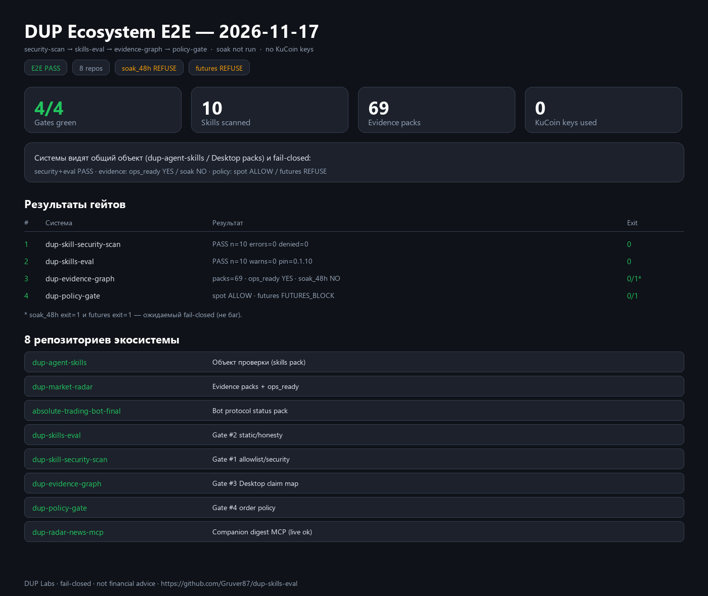

# DUP Evidence Graph

[](https://github.com/Gruver87/dup-evidence-graph/actions/workflows/ci.yml)

**Org:** [DUP Labs](https://github.com/Gruver87) · **Author:** Uladzimir Dabranski  
**Version:** `0.1.1` · Fail-closed queryable map of local evidence packs

Answers: *can this product claim X?* using packs on disk — never invents PASS.

## Ecosystem E2E — 8 repositories

End-to-end (2026-11-17): security-scan → skills-eval → evidence-graph → policy-gate → **PASS**.  
Dashboard: [`docs/assets/e2e-ecosystem-2026-11-17.png`](docs/assets/e2e-ecosystem-2026-11-17.png) · [PDF](docs/assets/e2e-ecosystem-2026-11-17.pdf) · also on [`dup-skills-eval`](https://github.com/Gruver87/dup-skills-eval#ecosystem-e2e-2026-11-17).



| Repo | Role in E2E |
|------|-------------|
| [`dup-agent-skills`](https://github.com/Gruver87/dup-agent-skills) | Object under test (skills pack) |
| [`dup-market-radar`](https://github.com/Gruver87/dup-market-radar) | Evidence packs + `ops_ready` |
| [`absolute-trading-bot-final`](https://github.com/Gruver87/absolute-trading-bot-final) | Bot protocol status pack |
| [`dup-skills-eval`](https://github.com/Gruver87/dup-skills-eval) | Gate #2 static / honesty |
| [`dup-skill-security-scan`](https://github.com/Gruver87/dup-skill-security-scan) | Gate #1 allowlist / security |
| [`dup-evidence-graph`](https://github.com/Gruver87/dup-evidence-graph) | Gate #3 Desktop claim map |
| [`dup-policy-gate`](https://github.com/Gruver87/dup-policy-gate) | Gate #4 order policy (`FUTURES_BLOCK`) |
| [`dup-radar-news-mcp`](https://github.com/Gruver87/dup-radar-news-mcp) | Companion digest MCP |
| [`dup-skill-trust-plane`](https://github.com/Gruver87/dup-skill-trust-plane) | Trust control plane + Skill Cards (post-E2E) |

### Product scan map (this tool)

| Product id | Default Desktop folder | Repo |
|------------|------------------------|------|
| `radar` | `dup-market-radar` | [`dup-market-radar`](https://github.com/Gruver87/dup-market-radar) |
| `bot` | `absolute-trading-bot-final` | [`absolute-trading-bot-final`](https://github.com/Gruver87/absolute-trading-bot-final) |
| `skills` | `dup-agent-skills` | [`dup-agent-skills`](https://github.com/Gruver87/dup-agent-skills) |
| `l1_pin` | `Absolute_Blockchain_Ultimate` | [`dup-protocol`](https://github.com/Gruver87/dup-protocol) |
| `l1_exp` | `Absolute_Blockchain_Experimental` | [`dup-protocol-experimental`](https://github.com/Gruver87/dup-protocol-experimental) |

## Install

```powershell
cd C:\Users\vovun\Desktop\dup-evidence-graph
python -m pip install -e ".[dev]"
.\scripts\test_all.ps1
.\scripts\scan_desktop.ps1
```

## Examples

```powershell
python -m evidence_graph query radar soak_48h
python -m evidence_graph query radar ops_ready
python -m evidence_graph query bot entries_unlocked
python -m evidence_graph board
python -m evidence_graph export --dir out
```

Exit code `1` on `query` when claim is **not** allowed (fail-closed).

## Related

- [`dup-skills-eval`](https://github.com/Gruver87/dup-skills-eval)
- [`dup-radar-news-mcp`](https://github.com/Gruver87/dup-radar-news-mcp)
- skill `l1-boundary` / `evidence-honesty`

## License

MIT — [`LICENSE`](LICENSE).
